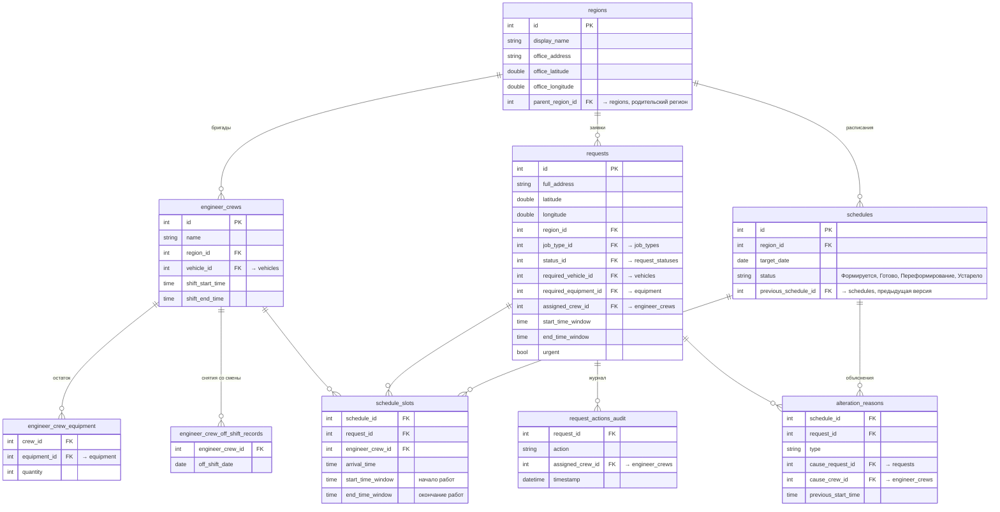

<div align="center">

# Планирование маршрутов выездных инженерных бригад

**Помощник диспетчера: распределяет заявки между бригадами, строит маршруты по реальным дорогам, перестраивает план при изменениях в течение дня и объясняет, почему план такой.**

Хакатон «Лидеры цифровой трансформации» 2026 · Кейс «Билайн Бизнес» · Команда «СливЯ»

![Java][java-badge]      ![Redis][redis-badge] [](LICENSE)

[Локальный запуск](#local-run) · [Как проверить](#demo) · [Соответствие ТЗ](#compliance) · [Алгоритм](#algorithm) · [Данные](#data) · [API](#api) · [Ограничения](#limitations)

</div>


<table>
  <tr>
    <td width="33%" align="center" valign="top">
      <br>
      <sub><b>Карта</b> — точки по типу работ, срочные заявки выделены</sub>
    </td>
    <td width="33%" align="center" valign="top">
      <br>
      <sub><b>Бригада</b> — маршрут с пробегом по участкам, назначенные заявки, снятие со смены</sub>
    </td>
    <td width="33%" align="center" valign="top">
      <br>
      <sub><b>Заявка</b> — окно визита, требования, точка на карте и история назначений</sub>
    </td>
  </tr>
</table>

---

## О проекте

У диспетчера выездной службы есть заявки на день и бригады. У бригад разные навыки, смены, транспорт, у заявок - адрес, тип работ и окно визита. В течение дня приходят аварийные заявки, клиенты отменяют визиты, бригады уходят со смены, и план приходится перестраивать.

Сервис делает это автоматически:

- **строит план на день** для каждого региона: какая бригада, в каком порядке и во сколько приезжает на каждую заявку. Это задача маршрутизации с временными окнами (VRPTW), её решает [Timefold Solver](https://timefold.ai/);
- **считает расстояния по графу дорог** OpenStreetMap через встроенный [GraphHopper](https://www.graphhopper.com/), время в пути зависит от транспорта и времени суток;
- **перепланирует** после срочной заявки, отмены заявки или снятия бригады со смены. Начатые и выполненные работы не трогаются, бригада продолжает маршрут с места последнего визита;
- **объясняет результат**: для каждой заявки вне плана показана причина, для каждого изменённого визита - что изменилось и из-за какого события;
- **показывает план**: таймлайн по бригадам, маршруты на карте, метрики, история версий расписания, ручное редактирование с проверкой ограничений.

<details>
<summary><b>Постановка задачи от организаторов</b></summary>

<br>

> Создайте понятный прототип, который распределяет заявки между инженерами, строит маршруты, показывает их на карте и умеет перестраивать план при изменениях.
>
> **Цель кейса:** сделать прототип помощника диспетчера, который предлагает выполнимый план и простыми словами объясняет своё решение.

**Что должно уметь решение:**

1. Загружать тестовые данные из CSV/JSON или использовать встроенный демонстрационный набор.
2. Распределять заявки между инженерами.
3. Определять порядок посещения адресов для каждого инженера.
4. Показывать маршруты и точки заявок на карте.
5. Отображать краткую информацию по плану: кто, куда и в какое время едет.
6. Перестраивать план после события: срочная заявка, отмена заявки, недоступность инженера.
7. Объяснять результат понятным диспетчеру языком.

**Обязательные ограничения:** квалификация (навык), время (смена инженера и временное окно заявки), ресурс (тип транспорта; оборудование — как дополнительное усложнение).

**Обязательные метрики:** количество задействованных исполнителей; пробег по каждому исполнителю и суммарный пробег плана.

Ссылка на задачу: [i.moscow/hackaton/lct](https://i.moscow/hackaton/lct/420731fd6e6b4b4c917428b62f125cdd)

</details>

---

<a id="local-run"></a>

## Локальный запуск

Система запускается через Docker Compose: так она переносима между машинами, а PostgreSQL, Redis и nginx поднимаются вместе с приложением.

**1. Создайте файл `.env`** в корне проекта из шаблона и заполните поля:

| Переменная | Назначение |
|---|---|
| `PG_DATABASE` | Название базы данных PostgreSQL |
| `PG_USER` | Имя пользователя PostgreSQL |
| `PG_PASSWORD` | Пароль пользователя PostgreSQL |
| `PG_CONNECTION_STRING` | Строка подключения к PostgreSQL |
| `GEOCODER_API_KEY` | API-ключ геокодера. Выпускается в [кабинете разработчика API Яндекс Карт](https://yandex.ru/maps-api/console) и начинает работать примерно через 15 минут после выпуска. Без ключа не работает создание заявок по адресу |

**2. Соберите и запустите окружение:**

```sh
docker compose -f compose.prod.yml up --build -d
```

Первая сборка занимает около 10 минут: загружаются нужные файлы, собираются контейнеры, строится кэш карты.

**3. Откройте** http://127.0.0.1:3000

### Возможные проблемы

> [!WARNING]
> **Ошибка загрузки `central-fed.osm.pbf` на шаге 2.** Скачайте файл вручную по ссылке https://lctbln.firsts3.ru/central-fed.osm.pbf, положите его в папку `maps/` в корне проекта и повторите команду из шага 2.

> [!WARNING]
> **Ошибка 502 на страницах приложения.** Пересоберите контейнер nginx, после этого запросы будут проходить нормально:
>
> ```sh
> docker compose -f compose.prod.yml down nginx && docker compose -f compose.prod.yml up nginx --build -d
> ```

---

<a id="demo"></a>

## Как проверить

<!-- 📝 Ссылка на развёрнутый стенд / видео-демо -->

| # | Шаг | Где в интерфейсе |
|---|---|---|
| 1 | Сформировать расписание | **Система → «Сформировать расписание»** |
| 2 | Выбрать регион: распределение заявок по бригадам, время визитов, метрики плана | **Расписание** |
| 3 | Посмотреть точки заявок и маршрут бригады | **Карта**; маршрут бригады — из её строки в расписании |
| 4 | Посмотреть заявки вне плана и причины | **Расписание → «Не вошли в расписание»** |
| 5 | Вызвать событие: создать заявку с типом «Глобальная проблема», отменить заявку или снять бригаду со смены | **Заявки → «Создать»**, карточка заявки, карточка бригады в **Исполнителях** |
| 6 | После пересчёта посмотреть изменённые визиты с причинами и сравнить с предыдущей версией | **Расписание → переключатель версий** |
| 7 | Вернуть всё в исходное состояние для повторного прогона | **Система → «Сбросить расписания»** |

---

<a id="compliance"></a>

## Соответствие требованиям кейса

| Требование | Как реализовано |
|---|---|
| Загрузка тестовых данных | Встроенный демо-набор (CSV по трём регионам) загружается при первом старте и проверяется валидатором — [`DatasetLoader`](server/src/main/java/stb/core/infrastructure/csv/DatasetLoader.java) |
| Распределение заявок и порядок посещения | Timefold Solver, отдельно для каждого региона. Маршрут бригады — упорядоченный список заявок — [`RoutingConstraintProvider`](server/src/main/java/stb/core/domain/service/scheduler/impl/logic/planning/RoutingConstraintProvider.java) |
| Маршруты и точки на карте | MapLibre GL, геометрия маршрута из GraphHopper — экраны «Карта» и «Расписание» |
| Кто, куда и когда едет | Таймлайн по бригадам: прибытие, ожидание, начало и конец работ — экран «Расписание» |
| Перепланирование | Срочная заявка, отмена заявки, снятие бригады со смены — [подробнее](#replanning) |
| Навык, смена и окно, транспорт, оборудование | Жёсткие ограничения Timefold Solver — [подробнее](#constraints) |
| Объяснение результата | Причина для каждой заявки вне плана и для каждого изменения после пересчёта — [подробнее](#explainability) |
| Метрика: число исполнителей | Минимизируется в Timefold Solver; на экране «Расписание» — «N / M бригад задействовано» |
| Метрика: пробег | По каждой бригаде в её строке и суммарный по региону |
| Сравнение с базовым вариантом | Не реализовано — см. [ограничения](#limitations) |

---

## Архитектура

<details>
<summary><b>Схема развёртывания</b></summary>

<br>


</details>

- **GraphHopper** работает внутри процесса сервера, внешних API маршрутизации и их лимитов нет.
- **Redis** кэширует матрицу расстояний региона и геометрию маршрутов бригад (TTL 48 ч).
- **Яндекс Геокодер** нужен только для перевода адреса новой заявки в координаты.

**Сервер** разделён на слои: `api` (REST-контроллеры) → `application` (по use case на сценарий) → `domain` (модели, Timefold Solver, события, порты). `infrastructure` реализует порты (GraphHopper, Redis, геокодер), загружает CSV, слушает события и запускает cron.

**Пересчёт асинхронный.** Запрос сохраняет изменение, переводит расписание в статус «Переформирование» и сразу отвечает. После коммита транзакции публикуется доменное событие, и слушатель запускает пересчёт в фоне:

| Событие | Когда | Обработчик |
|---|---|---|
| `SchedulesCreatedEvent` | «Сформировать расписание» или ночной cron | [`ScheduleCalculateUseCase`](server/src/main/java/stb/core/application/schedule/ScheduleCalculateUseCase.java) |
| `EmergencyCreatedEvent` | Создана заявка с типом «Глобальная проблема» | [`ScheduleEmergencyHandleUseCase`](server/src/main/java/stb/core/application/schedule/ScheduleEmergencyHandleUseCase.java) |
| `RequestCanceledEvent` | Заявка отменена | [`ScheduleRecalculateOnRequestCancelUseCase`](server/src/main/java/stb/core/application/schedule/ScheduleRecalculateOnRequestCancelUseCase.java) |
| `EngineerCrewTakenOffShiftEvent` | Бригада снята со смены | [`ScheduleRecalculateOnCrewOfShiftUseCase`](server/src/main/java/stb/core/application/schedule/ScheduleRecalculateOnCrewOfShiftUseCase.java) |

**Клиент** - Vue 3 + Pinia, по модулю на раздел в `client/src/features/`: `timeline` (расписание), `map`, `requests`, `crews`, `system`.

---

<a id="algorithm"></a>

## Алгоритм планирования

### Модель

Для каждого региона решается VRPTW с ресурсными ограничениями. Маршрут бригады начинается в её стартовой точке, возвращаться туда не нужно.

- **Что выбирает Solver.** Маршрут бригады — это упорядоченный список её заявок. Solver определяет, какие заявки войдут в маршрут каждой бригады и в каком порядке. Заявка может не попасть ни в один маршрут, тогда она оказывается в списке «Не вошли в расписание». В коде это `EngineerCrewDto.route` с аннотацией `@PlanningListVariable`.
- **Время** считается по цепочке: отъезд с предыдущей точки → время в пути → прибытие → начало работ = `max(прибытие, начало окна)` → окончание. Длительность работ задаётся типом работ.
- **Оценка плана** складывается из штрафов трёх уровней: hard, medium и soft (`HardMediumSoftScore`, правила — ниже).
- **Время расчёта.** Solver перебирает варианты и улучшает план, пока не пройдёт 30 секунд или пока на протяжении 10 секунд не найдётся ничего лучше. Результатом становится лучший найденный план ([`solverConfig.xml`](server/src/main/resources/solverConfig.xml)).

<a id="constraints"></a>

### Ограничения и критерии

Уровни сравниваются лексикографически: любое нарушение hard хуже любого medium, medium хуже любого soft. Поэтому Solver сначала ищет **допустимый** план, затем ставит в него **как можно больше заявок** и только потом сокращает **число бригад и пробег**.

| Уровень | Правило | Штраф |
|---|---|---|
| **Hard** | У бригады есть навык, который требует тип работ | 1 за заявку |
| | Если заявка требует транспорт - он совпадает с транспортом бригады | 1 за заявку |
| | Прибытие не позже конца окна заявки | 1 за заявку |
| | Работы заканчиваются до конца смены бригады | 1 за заявку |
| | Первичный план: заявок с оборудованием не больше вместимости транспорта | 1 за каждую заявку сверх вместимости |
| | Пересчёт: оборудования у бригады в наличии хватает на её заявки | 1 за каждую заявку, на которую не хватило оборудования |
| **Medium** | Заявка вне плана | срочная 1000, подключение 10, прочие 1 |
| | Пересчёт: привлечена бригада, у которой не было визитов в текущей версии | 5000 |
| | Срочная заявка начинается позже начала окна | 1 за каждые 10 мин |
| **Soft** | Бригада задействована | 1 000 000 |
| | Срочная заявка начинается позже начала окна | 1000 за мин |
| | Заявка из чужого подрайона | 20 000 за км по прямой от офиса бригады |
| | Пробег | 1 за км |
| | Время в пути | 1 за мин |

Одна лишняя бригада весит как миллион километров пробега, поэтому Solver сначала сокращает **число исполнителей**, а при том же составе — **пробег** (обе обязательные метрики ТЗ). Штраф за чужой подрайон сопоставим с ценой бригады только на расстояниях от 50 км.

### Время в пути

- **Расстояния.** Точки региона — это стартовые точки бригад и адреса заявок. Перед расчётом GraphHopper строит маршрут по дорогам между каждой парой таких точек, маршруты строятся параллельно. По длинам маршрутов получается матрица расстояний «каждая точка с каждой». Она сохраняется в Redis, чтобы при повторных расчётах не строить маршруты заново.
- **Скорость** = средняя скорость транспорта × коэффициент времени суток. Поездка через границу интервалов считается по частям.

| Интервал | 00–07 | 07–09 | 09–16 | 16–19 | 19–24 |
|---|:---:|:---:|:---:|:---:|:---:|
| Коэффициент | 1,00 | 0,90 | 1,10 | 0,75 | 1,00 |

| Транспорт | Средняя скорость | Вместимость, ед. оборудования |
|---|:---:|:---:|
| Автомобиль | 60 км/ч | 100 |
| Общественный транспорт | 38 км/ч | 4 |
| Велосипед | 18 км/ч | 6 |
| Пешком | 5 км/ч | 4 |

<a id="replanning"></a>

### Перепланирование

Все три события обрабатывает [`ScheduleRecalculationService`](server/src/main/java/stb/core/domain/service/ScheduleRecalculationService.java):

1. Визиты в статусах «В работе» и «Выполнена» переносятся в новую версию без изменений.
2. Бригада стартует из места и времени окончания своего последнего визита. Снятые со смены бригады в расчёт не попадают. Для оборудования берётся реальный остаток у бригады.
3. Пересчитываются заявки в статусах «Не назначена» и «Назначена». Штраф medium не даёт без необходимости привлекать новые бригады.
4. Каждый визит сравнивается с прошлой версией: добавлен, передан другой бригаде, перенесён по времени или снят с расписания.
5. Сохраняется новая версия, старая получает статус «Устарело» и остаётся в истории.

Срочная заявка вытесняет обычные за счёт штрафа: её отсутствие в плане стоит 1000, обычной — 1–10. При отмене освободившееся время занимают другие заявки. При снятии бригады её незавершённые заявки распределяются между остальными.

<a id="explainability"></a>

### Объяснимость

Объяснения не зависят от того, как устроен алгоритм планирования. Они строятся только по результату расчёта (какая заявка какой бригаде и на какое время назначена) и по данным о заявках, бригадах и событиях. Внутреннее состояние Timefold Solver и его оценка для этого не нужны. Поэтому Solver можно заменить на собственный алгоритм, другую библиотеку или LLM, а объяснения продолжат работать без изменений.

LLM для формирования текстов мы сознательно не используем. Все причины - это конечный набор ситуаций, которые определяются по данным, так что генерация текста здесь ничего не добавляет. Шаблоны дают одинаковый текст для одинаковой ситуации, не могут придумать несуществующую причину и не требуют внешнего сервиса.

Каждое объяснение — это запись [`AlterationReason`](server/src/main/java/stb/core/domain/model/AlterationReason.java), привязанная к версии расписания и к заявке. В записи хранятся тип причины и её контекст: событие, из-за которого был пересчёт, и прежнее время визита. Текст для диспетчера собирается из этих данных, поэтому в нём есть конкретные номера заявок, названия бригад и навыков, время. Предыдущие версии расписания вместе с их объяснениями остаются в истории.

**Почему заявка не вошла в план.** Причина определяется по бригадам на смене. Сначала проверяется, может ли заявку в принципе выполнить хоть одна бригада. Такую причину диспетчер может устранить сам, например выпустив на смену бригаду с нужным навыком. Если подходящие бригады есть, значит им не хватило времени или оборудования.

| Причина | Пример текста |
|---|---|
| Ни у одной бригады на смене нет нужного навыка | «Среди бригад на смене нет бригады с навыком «Аварийные работы»» |
| Бригады с навыком есть, но без нужного транспорта | «Среди бригад на смене с нужным навыком нет бригады с транспортом «Автомобиль»» |
| Срочная заявка, для которой подходящие бригады есть | «Срочная заявка не распределена: подходящие бригады не могут начать выполнение в течение 100 минут после создания заявки (до 14:40)» |
| Подходящие бригады заняты | «У подходящих бригад не нашлось свободного времени в окне визита 18:00–20:00» |

Если заявке нужно оборудование, к последнему тексту добавляется «…или оборудования «Роутер»». Остаток оборудования у бригад при этой проверке не учитывается, поэтому нехватку времени и нехватку оборудования текст не различает.

**Что изменилось после пересчёта.** Новая версия расписания сравнивается с предыдущей по каждой заявке. Изменение относится к одному из четырёх видов, и в тексте всегда указано событие, которое вызвало пересчёт:

| Изменение | Пример текста |
|---|---|
| Заявка добавлена в расписание | «Заявка добавлена в расписание при пересчёте после отмены заявки №41077» |
| Передана другой бригаде | «Заявка передана другой бригаде при пересчёте после снятия бригады «Бригада Паршин» со смены» |
| Визит перенесён больше чем на 10 минут | «Визит перенесён (вместо 15:30) при пересчёте после поступления срочной заявки №999» |
| Снята с расписания | «Заявка снята с расписания при пересчёте после поступления срочной заявки №999» |

---

<a id="data"></a>

## Данные

### Демо-набор

Загружается при первом старте, если база пуста.

| Регион | Бригад | Заявок | Событий |
|---|:---:|:---:|:---:|
| Восток | 12 | 66 | 3 |
| Юго-восток | 12 | 83 | 3 |
| Югоцентр | 11 | 56 | 3 |
| **Итого** | **35** | **205** | **9** |

### Формат файлов

На каждый регион три файла в `server/src/main/resources/demo/dataset/<регион>/`. Разделитель `;`, UTF-8, время `HH:MM`, координаты WGS-84.

<details>
<summary><b>requests.csv — заявки</b></summary>

<br>

| Поле | Описание | Пример |
|---|---|---|
| `id` | ID заявки | 74198 |
| `address` | Адрес | Город Москва, пр-кт.Волгоградский, д. 128 к 5 |
| `latitude`, `longitude` | Координаты | 55.700867, 37.782225 |
| `duration_minutes` | Длительность, мин. Проверяется валидатором, в расчёте используется длительность типа работ | 70 |
| `window_start`, `window_end` | Окно визита | 20:00, 22:00 |
| `required_vehicle` | Требуемый транспорт, необязательно | CAR |
| `job_type` | Тип работ | INSTALLATION |
| `required_equipment` | Требуемое оборудование, необязательно | ROUTER |

</details>

<details>
<summary><b>engineers.csv — бригады</b></summary>

<br>

| Поле | Описание | Пример |
|---|---|---|
| `id`, `name` | ID и название бригады | 1, Бригада Соколов |
| `start_address` | Адрес стартовой точки | г. Москва, ул Юных Ленинцев, д 83с 4 |
| `start_latitude`, `start_longitude` | Координаты старта | 55.700320, 37.747940 |
| `shift_start`, `shift_end` | Смена | 10:00, 22:00 |
| `skills` | 1–3 навыка через `\|` | LOCAL_WORK\|EMERGENCY |
| `vehicle` | Тип транспорта | PEDESTRIAN |
| `district` | Подрайон, необязательно. Бригада без подрайона задаёт офис региона | — |

</details>

<details>
<summary><b>events.csv — сценарий событий</b></summary>

<br>

| Поле | Описание |
|---|---|
| `event_type` | `URGENT_REQUEST` / `CANCEL_REQUEST` / `ENGINEER_UNAVAILABLE` |
| `event_time` | Время события |
| `request_id` | ID отменяемой или новой срочной заявки |
| `engineer_id` | ID выбывшей бригады |
| `request_*` | Для срочной заявки — поля новой заявки |

</details>

[`DatasetValidator`](server/src/main/java/stb/core/infrastructure/csv/DatasetValidator.java) перед загрузкой проверяет уникальность ID, корректность окон и смен, число навыков и то, что события ссылаются на существующие заявки и бригады.

### Справочники

| Тип работ | Код | Навык | Длительность |
|---|---|---|:---:|
| Локальная заявка | `LOCAL_WORK` | Локальные работы (`LOCAL_WORK`) | 30 мин |
| Подключение | `INSTALLATION` | Подключения и дозаказы (`INSTALLATION_OR_ADDON`) | 70 мин |
| Дозаказ оборудования | `ADDON` | Подключения и дозаказы (`INSTALLATION_OR_ADDON`) | 20 мин |
| Глобальная проблема (**срочная**) | `EMERGENCY` | Аварийные работы (`EMERGENCY`) | 80 мин |

Транспорт: `CAR`, `PUBLIC_TRANSPORT`, `BICYCLE`, `PEDESTRIAN`. Оборудование: `ROUTER` (роутер), `SET_TOP_BOX` (ТВ-приставка), `SMART_SPEAKER` (умная колонка).

<details>
<summary><b>Схема базы данных</b></summary>

<br>

На схеме — основные таблицы и их ключевые поля. Справочники `vehicles`, `skills`, `job_types`, `equipment` и `request_statuses` показаны только внешними ключами с пометкой `→`, чтобы не перегружать схему. Навыки бригад и навыки, которые требует тип работ, хранятся в связующих таблицах `engineer_crew_skills` и `job_type_required_skills`.



</details>

---

<a id="api"></a>

## API

Префикс `/api/v1`. Ответы приходят в конверте `{ "statusCode", "error", "message", "payload" }`. Списки поддерживают `page` (с 1), `limit` (по умолчанию 20) и `sort`.

| Метод | Путь | Назначение |
|---|---|---|
| `GET` | `/regions` | Регионы |
| `GET` | `/requests` | Поиск заявок с фильтрами |
| `GET` | `/requests/{id}` | Карточка заявки с историей действий |
| `GET` | `/requests/map?regionId=` | Точки заявок региона для карты |
| `POST` | `/requests` | Создать заявку; аварийная запускает пересчёт |
| `PATCH` | `/requests/{id}/in_progress` | Бригада приступила к работе |
| `PATCH` | `/requests/{id}/complete` | Заявка выполнена |
| `PATCH` | `/requests/{id}/cancel` | Отменить заявку; запускает пересчёт |
| `GET` | `/crews` | Поиск бригад с фильтрами |
| `GET` | `/crews/{id}` | Карточка бригады |
| `POST` | `/crews/{id}/equipment` | Выдать оборудование |
| `PATCH` | `/crews/{crewId}/offShift` | Снять бригаду со смены; запускает пересчёт |
| `POST` | `/schedules/initialize` | Сформировать расписание на сегодня для всех регионов |
| `GET` | `/schedules/regions/{regionId}` | Текущая версия расписания региона |
| `GET` | `/schedules/{scheduleId}` | Конкретная версия расписания |
| `GET` | `/schedules/{scheduleId}/crews/{crewId}/route` | Маршрут бригады: геометрия и пробег |
| `POST` | `/schedules/regions/{regionId}/preview` | Проверить ручное редактирование |
| `PUT` | `/schedules/regions/{regionId}/routes` | Применить ручное редактирование |
| `POST` | `/schedules/reset` | Сбросить расписания и статусы заявок |

---

## Структура репозитория

```
.
├── client/                              # фронтенд, Vue 3 + TypeScript
│   └── src/features/                    # разделы: timeline, map, requests, crews, system
├── server/                              # бэкенд, Spring Boot
│   └── src/
│       ├── main/java/stb/core/
│       │   ├── api/                     # REST-контроллеры
│       │   ├── application/             # use case по сценариям
│       │   ├── domain/
│       │   │   ├── service/scheduler/   # модель и ограничения Timefold
│       │   │   ├── model/               # сущности JPA
│       │   │   ├── event/               # доменные события
│       │   │   └── port/                # интерфейсы внешних сервисов
│       │   └── infrastructure/          # GraphHopper, Redis, геокодер, CSV, слушатели, cron
│       ├── main/resources/
│       │   ├── demo/dataset/            # демо-набор
│       │   └── solverConfig.xml
│       └── generator/                   # генератор демо-набора
├── nginx/                               # reverse proxy
├── maps/                                # OSM-файл (не в git)
├── compose.yml
└── .env.example
```

---

## Конфигурация

Переменные `.env` описаны в разделе [«Локальный запуск»](#local-run). Остальные параметры сервера заданы в [`compose.yml`](compose.yml): путь к OSM-файлу и кэшу графа, подключение к Redis, `TZ=Europe/Moscow` (от часового пояса зависят «сегодня» и время визитов). Значения по умолчанию — в [`application.yml`](server/src/main/resources/application.yml).

---

<a id="limitations"></a>

## Ограничения прототипа

- **Один дорожный граф для всех видов транспорта.** Расстояния считаются по автомобильному профилю GraphHopper, транспорт различается только средней скоростью. Общественный транспорт — 38 км/ч, без расписания и пересадок.
- **Загруженность дорог** задана фиксированными коэффициентами по времени суток, без данных о пробках.
- **Нет текста «почему именно эта бригада»** для заявок, назначенных при первичном расчёте. Причины есть для заявок вне плана и для изменений после пересчёта.

---

## Команда «СливЯ»

| Участник | Роль | Telegram |
|---|---|---|
| **Степан Богомазов** | Капитан, фулстек-разработчик, менеджер проекта | [@ivivigfj](https://t.me/ivivigfj) |
| **Илья Иванов** | Фулстек-разработчик | [@seenseey](https://t.me/seenseey) |
| **Елизавета Васильева** | Бэкенд-разработчик | [@lizooooch](https://t.me/lizooooch) |
| **Владислав Желтов** | Фулстек-разработчик | [@vladzht](https://t.me/vladzht) |
| **Роман Черняк** | Бэкенд-разработчик | [@ag_gse](https://t.me/ag_gse) |

<!-- Логотипы Java и Redis из Devicon (MIT) -->
[java-badge]: https://img.shields.io/badge/Java-25-E76F00?logo=data:image/svg+xml;base64,PHN2ZyBmaWxsPSIjZmZmIiB4bWxucz0iaHR0cDovL3d3dy53My5vcmcvMjAwMC9zdmciIHZpZXdCb3g9IjAgMCAxMjggMTI4Ij48cGF0aCBmaWxsPSIjZmZmIiBkPSJNNDcuNjE3IDk4LjEyYy0xOS4xOTIgNS4zNjIgMTEuNjc3IDE2LjQzOSAzNi4xMTUgNS45NjktNC4wMDMtMS41NTYtNi44NzQtMy4zNTEtNi44NzQtMy4zNTEtMTAuODk3IDIuMDYtMTUuOTUyIDIuMjIyLTI1Ljg0NCAxLjA5Mi04LjE2NC0uOTM1LTMuMzk3LTMuNzEtMy4zOTctMy43MXptMzMuMTg5LTEwLjQ2Yy0xNC40NDQgMi43NzktMjIuNzg3IDIuNjktMzMuMzU0IDEuNi04LjE3MS0uODQ1LTIuODIyLTQuODA1LTIuODIyLTQuODA1LTIxLjEzNyA3LjAxNiAxMS43NjcgMTQuOTc3IDQxLjMwOSA2LjMzNi0zLjE0LTEuMTA2LTUuMTMzLTMuMTMxLTUuMTMzLTMuMTMxem0xMS4zMTktNjAuNTc1Yy4wMDEgMC00Mi43MzEgMTAuNjY5LTIyLjMyMyAzNC4xODcgNi4wMjQgNi45MzUtMS41OCAxMy4xNy0xLjU4IDEzLjE3czE1LjI4OS03Ljg5MSA4LjI2OS0xNy43NzdjLTYuNTU5LTkuMjE1LTExLjU4Ny0xMy43OTMgMTUuNjM0LTI5LjU4em05Ljk5OCA4MS4xNDRzMy41MjkgMi45MS0zLjg4OCA1LjE1OWMtMTQuMTAyIDQuMjcyLTU4LjcwNiA1LjU2LTcxLjA5NS4xNzEtNC40NS0xLjkzOCAzLjg5OS00LjYyNSA2LjUyNi01LjE5MiAyLjczOS0uNTkzIDQuMzAzLS40ODUgNC4zMDMtLjQ4NS00Ljk1Mi0zLjQ4Ny0zMi4wMTMgNi44NS0xMy43NDIgOS44MTUgNDkuODIxIDguMDc2IDkwLjgxNy0zLjYzNyA3Ny44OTYtOS40Njh6TTg1IDc3Ljg5NmMyLjM5NS0xLjYzNCA1LjcwMy0zLjA1MyA1LjcwMy0zLjA1M3MtOS40MjQgMS42ODUtMTguODEzIDIuNDc0Yy0xMS40OTQuOTY0LTIzLjgyMyAxLjE1NC0zMC4wMTIuMzI2LTE0LjY1Mi0xLjk1OSA4LjAzMy03LjM0OCA4LjAzMy03LjM0OHMtOC44MTItLjU5Ni0xOS42NDQgNC42NDRDMTcuNDU1IDgxLjEzNCA2MS45NTggODMuOTU4IDg1IDc3Ljg5NnptNS42MDkgMTUuMTQ1Yy0uMTA4LjI5LS40NjguNjE2LS40NjguNjE2IDMxLjI3My04LjIyMSAxOS43NzUtMjguOTc5IDQuODIyLTIzLjcyNS0xLjMxMi40NjQtMiAxLjU0My0yIDEuNTQzcy44MjktLjMzNCAyLjY3OC0uNzJjNy41NTktMS41NzUgMTguMzg5IDEwLjExOS01LjAzMiAyMi4yODZ6TTY0LjE4MSA3MC4wNjljLTQuNjE0LTEwLjQyOS0yMC4yNi0xOS41NTMuMDA3LTM1LjU1OUM4OS40NTkgMTQuNTYzIDc2LjQ5MiAxLjU4NyA3Ni40OTIgMS41ODdjNS4yMyAyMC42MDgtMTguNDUxIDI2LjgzMy0yNi45OTkgMzkuNjY3LTUuODIxIDguNzQ1IDIuODU3IDE4LjE0MiAxNC42ODggMjguODE1em0yNy4yNzQgNTEuNzQ4Yy0xOS4xODcgMy42MTItNDIuODU0IDMuMTkxLTU2Ljg4Ny44NzQgMCAwIDIuODc0IDIuMzggMTcuNjQ2IDMuMzMxIDIyLjQ3NiAxLjQzNyA1Ny0uOCA1Ny44MTYtMTEuNDM2LjAwMSAwLTEuNTcgNC4wMzItMTguNTc1IDcuMjMxeiIvPjwvc3ZnPg==
[redis-badge]: https://img.shields.io/badge/Redis-7.4-DC382D?logo=data:image/svg+xml;base64,PHN2ZyBmaWxsPSIjZmZmIiB4bWxucz0iaHR0cDovL3d3dy53My5vcmcvMjAwMC9zdmciIHZpZXdCb3g9IjAgMCAxMjggMTI4Ij48cGF0aCBkPSJNNi4yIDUyLjdjNi43IDMuMiA0My43IDE4LjEgNDkuNSAyMC45IDUuOCAyLjggMTAgMi44IDE3LjQtMSA3LjQtMy45IDQyLjItMTguMSA0OC45LTIxLjYgMy40LTEuOCA0LjktMy4yIDQuOS00LjRWMzQuMWMwLTEuMy0xLjctMi40LTUtMy42LTYuNS0yLjQtNDEuMS0xNi4xLTQ3LjctMTguNi02LjYtMi40LTkuMy0yLjMtMTcuMS41QzQ5LjMgMTUuMiAxMi42IDI5LjYgNiAzMi4yYy0zLjIgMS4zLTUgMi40LTUgMy43SC44djEyLjdjLjIgMS4yIDIuMSAyLjUgNS40IDQuMXptNjAuNCAxLjhsLTIwLjMtOC40IDI5LjEtNC41LTguOCAxMi45em00NC4xLTIwbC0xNy4yIDYuOC0xLjkuNy0xNy4yLTYuOCAxOS4xLTcuNSAxNy4yIDYuOHpNNjAuMSAyMmwtMi44LTUuMiA4LjggMy40IDguMy0yLjctMi4yIDUuNCA4LjQgMy4yLTEwLjkgMS4xLTIuNCA1LjktMy45LTYuNS0xMi42LTEuMSA5LjMtMy41em0tMjEuNyA3LjNjOC42IDAgMTUuNiAyLjcgMTUuNiA2cy03IDYtMTUuNiA2LTE1LjYtMi43LTE1LjYtNiA3LTYgMTUuNi02ek0xMjIgNTkuOGMtNi43IDMuNS00MS40IDE3LjgtNDguOCAyMS42LTcuNCAzLjktMTEuNSAzLjgtMTcuMyAxLTUuOC0yLjgtNDMtMTcuNy00OS42LTIwLjlDMi45IDU5LjkgMSA1OC42IDEgNTcuM1Y3MGMwIDEuMyAxLjkgMi42IDUuMiA0LjIgNi43IDMuMiA0My43IDE4LjEgNDkuNSAyMC45IDUuOCAyLjggMTAgMi44IDE3LjQtMSA3LjQtMy45IDQyLjItMTguMSA0OC45LTIxLjYgMy40LTEuOCA0LjktMy4yIDQuOS00LjRWNTUuNmMwIDEuMS0xLjYgMi41LTQuOSA0LjJ6bTAgMjAuN2MtNi43IDMuNS00MS40IDE3LjgtNDguOCAyMS42LTcuNCAzLjktMTEuNSAzLjgtMTcuMyAxLTUuOC0yLjgtNDMtMTcuNy00OS42LTIwLjlDMi45IDgwLjcgMSA3OS4zIDEgNzh2MTIuN2MwIDEuMyAxLjkgMi42IDUuMiA0LjIgNi43IDMuMiA0My43IDE4LjEgNDkuNSAyMC45IDUuOCAyLjggMTAgMi44IDE3LjQtMSA3LjQtMy45IDQyLjItMTguMSA0OC45LTIxLjYgMy40LTEuOCA0LjktMy4yIDQuOS00LjRWNzYuM2MwIDEuMi0xLjYgMi41LTQuOSA0LjJ6IiBmaWxsPSIjZmZmIi8+PC9zdmc+
